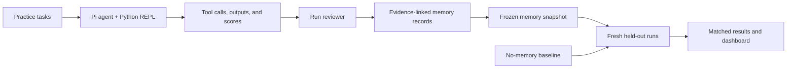

# Pi memory research

An isolated research harness for testing whether **procedural memory** (reusable ways to act) and **metacognitive memory** (lessons about observed weaknesses) help a Pi coding agent on new tasks. The model and tools stay fixed while the memory given to a fresh run changes. This project does not modify Pi or restore a Pi runtime inside Optimus.

The current prototype uses `@earendil-works/pi-coding-agent` **0.74.2** with **GLM 5.3 Flash** through Particle AI. It includes an interactive Python/Jupyter tool, practice-run review, versioned memory records, matched evaluation runs, and a local dashboard. It is a research prototype, not a demonstrated general memory improvement.

## How it works



Pi receives a task, chooses tool calls, observes their results, and decides what to do next. The REPL lets it write and run Python search code; variables persist between cells **within one session**. The separate reviewer examines practice traces and proposes lessons. Evaluation runs start fresh and receive either no memory, procedural memory, metacognitive memory, or both. Memory is built from practice only and frozen before evaluation.

## Setup on Windows PowerShell

Install Node.js and Python, then run from the repository root:

```powershell
npm ci
py -3 -m venv .venv-repl
.\.venv-repl\Scripts\python.exe -m pip install -r requirements-repl.lock.txt
```

Particle AI access is needed for model-backed runs. Set `ARKENOS_PARTICLE_AI_API_KEY` in your local environment; never put the key in a committed file. Create Pi's isolated local provider configuration once:

```powershell
.\.venv-repl\Scripts\python.exe -c "from pathlib import Path; from src.runner import setup_isolated_env; setup_isolated_env(Path.cwd())"
```

This writes `.pi_isolated/models.json`, which is ignored by Git. The configuration records the local key, so keep that directory private. To change the key later, update the local configuration as well; merely changing the environment variable does not replace a file that already exists.

### Start an interactive Pi agent

```powershell
.\start-repl.cmd
```

Try asking: *“Use `python_cell` to create a small Python list, then use another cell to calculate its sum. Show me `python_history`.”* The agent can call `python_cell`, `python_history`, and `python_reset`; notebooks from these sessions are written locally. The Python kernel runs with your computer's file permissions, so use a suitable working directory and inspect agent actions. See [REPL_README.md](REPL_README.md) for tool behavior and limits.

To test the REPL bridge without model calls:

```powershell
.\.venv-repl\Scripts\python.exe .\src\test_jupyter_bridge.py
```

## Run a memory experiment

The multi-file benchmark uses generated synthetic notebook fixtures. The builder creates a local corpus and evaluation keys; keep those keys outside the agent's working directory and review them before publishing. From the repository root:

```powershell
.\.venv-repl\Scripts\python.exe .\search_research\build_multihop.py
.\.venv-repl\Scripts\python.exe -m unittest discover -s search_research/tests -v
.\.venv-repl\Scripts\python.exe .\search_research\run_multihop.py
```

The last command makes provider calls and writes a new experiment under `search_research/runs/`. Each condition uses fresh processes and kernels. The runner records the chosen memory, tool calls, tool results, answers, scores, tokens, and time. See [MULTIHOP_EXPERIMENT.md](search_research/MULTIHOP_EXPERIMENT.md) for the task design and audit commands, and [search_research/README.md](search_research/README.md) for the earlier notebook-search experiment and controls.

### Inspect saved runs

```powershell
.\.venv-repl\Scripts\python.exe .\search_research\dashboard.py
```

Open <http://127.0.0.1:8765/>. Select an experiment and a run to see the comparison, injected lesson, Python actions, observed tool outputs, and evaluation. This is a read-only viewer of saved files; it does not launch runs or live-stream execution. An empty dashboard means no compatible experiment has been run locally yet.

## Pilot results

In one recorded multi-file pilot, **3 practice questions** produced frozen lessons, then **6 held-out questions** were tested once under each of four conditions (24 evaluation runs). All numeric answers were correct. The initial comparison recorded:

| Memory condition | Mean tool calls | Tool errors |
|---|---:|---:|
| None | 6.00 | 2 |
| Procedural | 4.33 | 1 |
| Metacognitive | 5.00 | 0 |
| Both | 6.83 | 1 |

One combined-memory run had a citation/evidence issue despite a correct number. A later evidence audit corrected a scoring rule uniformly across conditions; the original run outputs were retained. The [pilot report](search_research/MULTIHOP_EXPERIMENT.md) explains that audit, and the [task-level review](search_research/WEEK3_ANALYSIS.md) shows why the averages are fragile: one difficult task accounts for much of the apparent gain. **One repetition does not establish a reliable improvement.** The next useful test is repeated matched runs with the same frozen memories, followed by selective-retrieval and stale/conflicting-memory conditions.

## Repository map

- `src/`: baseline runner, trajectory logger, REPL bridge, and small experiments.
- `extensions/`: Pi's Jupyter tool and research limits.
- `memory_adapters/`: procedural and episodic adapter code and shared interfaces.
- `search_research/`: procedural/metacognitive search-memory experiment, fixture builders, tests, analyses, and dashboard.
- `evaluation/`: outcome checks and metrics.
- `task_splits/` and `configs/`: versioned experimental definitions where released.

Generated workspaces, notebooks, raw trajectories, local provider configuration, credentials, and virtual environments are not source files. Keep evaluation answers separate from any directory the worker can inspect. The current pilot measures a narrow form of transfer on synthetic tasks; it does not establish transfer to arbitrary repositories or automatic edits to `AGENTS.md` or `SKILL.md`.
